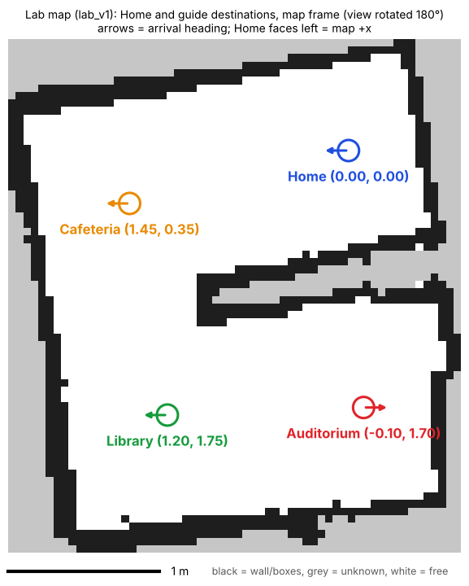

# Limo Pro Lab Guide Robot (real robot)

A guide robot on the AgileX Limo Pro (ROS 2 Foxy, Jetson): a visitor picks a place by button or voice on a laptop GUI, the robot drives there with Nav2, turns to face the place, waits 10 s and returns home. Demo room 3.0 × 3.4 m with four places (Home, Auditorium, Library, Cafeteria). The Gazebo simulation of the same guide is in [limo-ros2-campus-guide-robot](https://github.com/mmuzaffark/limo-ros2-campus-guide-robot).

## Demo video

[](https://youtu.be/WnRJRKCcmM4)

Watch on YouTube: <https://youtu.be/WnRJRKCcmM4>

## Map and places



Demo map `robot/maps/lab_v1` (3.0 × 3.4 m, 5 cm cells), drawn turned 180° so Home is top right. Coordinates are in the map frame (m); arrows show the heading on arrival. Places are in `robot/places_lab.yaml`.

## Results (29 Oct 2026)

| Test | Result |
| --- | --- |
| Navigation test, 2 rounds (`robot/logs/nav_test_20261029_1244.csv`) | 6/6 places; parking error mean 0.18 m, max 0.23 m; heading error max 5.3° |
| Guide trials (`robot/logs/trials_20261029_1323.csv`) | 12/12 arrived, 0 collisions; parking mean 0.175 m; heading mean 4.4° |
| Power-on start (systemd service `limo-guide`) | ready ~40 s after boot, localization 100 % |
| Autonomous mapping (explore_lite) | limitation: stops early in the small room and smears frame-style furniture in the main lab; the demo map was made by hand |

`RESULTS.md` has all logged runs (calibration, mapping, navigation tests, trials).

## Layout

| Path | Contents |
| --- | --- |
| `install_guide.sh` | Rebuilds the whole robot side (`~/guide_ws`): scripts, launch files, parameters, places, service. Byte-identical to the robot's files |
| `robot/scripts` | Guide manager, Nav2 start, localization check, heading alignment, nav test, trials, mapping, calibration |
| `robot/params`, `robot/launch` | Nav2 (RPP controller), SLAM, explore, EKF parameters; base launch with EKF |
| `robot/maps` | `lab_v1` = demo map; other maps from the mapping runs |
| `robot/setup_prereqs.sh` | One-time robot setup before `install_guide.sh` |
| `robot/patches` | `fix_rpp_goal_dist_tol.sh`: fix for the Nav2 RPP controller in the robot's source build |
| `robot/logs` | CSV logs of every test |
| `laptop` | Windows GUI with voice (`lab_gui_win.py`), `setup_laptop.ps1`, `requirements.txt`, start and sync scripts |

## Quick start

Needs an AgileX **Limo Pro** with its factory image (Ubuntu 20.04, ROS 2 Foxy, AgileX `limo_ros2_ws` with the Nav2 0.4.7 source build), Wi-Fi with internet for the setup, and a Windows laptop on the same network. The robot side is tested only on this hardware.

**Robot** (SSH or the robot's screen; sudo password on a Limo is `AGX`; answer `2` (foxy) if the login asks noetic/foxy):

```bash
git clone https://github.com/mmuzaffark/limo-pro-lab-guide-robot.git ~/limo-pro-lab-guide-robot
bash ~/limo-pro-lab-guide-robot/robot/setup_prereqs.sh    # apt packages, tmux, ~/guide_env.sh, explore_lite e40e857, Nav2 RPP fix, demo map
tmux new -s guide                                          # all later robot commands run inside tmux
bash ~/limo-pro-lab-guide-robot/install_guide.sh           # scripts, launch, parameters, places, limo-guide service (not enabled)
~/guide_ws/scripts/make_cyclone.sh LAPTOP_IP               # DDS config with the laptop as peer
```

**Laptop** (PowerShell, Python 3.12 from python.org or `winget install -e --id Python.Python.3.12`):

```powershell
git clone https://github.com/mmuzaffark/limo-pro-lab-guide-robot.git
powershell -ExecutionPolicy Bypass -File .\limo-pro-lab-guide-robot\laptop\setup_laptop.ps1 -RobotIp ROBOT_IP
```

It installs `laptop/requirements.txt`, copies the GUI to `%USERPROFILE%\lab`, and sets up the SSH shortcut `limo` with a key.

**Run:** robot on the Home mark, facing the way it faced when the map was started: `~/guide_ws/scripts/guide_start.sh` on the robot (or `sudo systemctl enable --now limo-guide` to start at every power-on), then `powershell -ExecutionPolicy Bypass -File $env:USERPROFILE\lab\start_gui.ps1` on the laptop. The status line shows `idle home ready` and the link line turns green.

## Set up in a new room

The map and places in the repo are for the original 3.0 × 3.4 m room. For any other room, make your own once (about 30 min):

1. **Home mark.** Put tape on the floor where the robot will start and return; the robot's start pose there is the map origin (0, 0, facing +x).
2. **Map by driving** (robot on the Home mark; one tmux window each, `Ctrl-b c`):
   ```bash
   ros2 launch ~/guide_ws/launch/limo_start_guide.launch.py                                        # T1 base + lidar + EKF
   ros2 run slam_toolbox async_slam_toolbox_node --ros-args --params-file ~/guide_ws/params/slam_lab.yaml   # T2 SLAM
   ros2 run teleop_twist_keyboard teleop_twist_keyboard --ros-args -p speed:=0.15 -p turn:=0.5      # T3 drive
   ```
   Turn once in place, drive the perimeter 0.3-0.5 m from the walls, one pass through the middle, back to Home. Turn slowly. Keep gaps the robot must pass at least 0.9 m wide. Then save (T4) and stop T1-T3:
   ```bash
   ros2 run nav2_map_server map_saver_cli -f ~/guide_ws/maps/lab_auto
   python3 ~/guide_ws/scripts/map_clean.py ~/guide_ws/maps/lab_auto.yaml lab_v1      # fills table/chair legs; writes maps/lab_v1.*
   ```
3. **Localize:** robot on Home, T1 `~/guide_ws/scripts/nav_start.sh`, T2 `python3 ~/guide_ws/scripts/loc_check.py --fix` (needs `LOC CHECK: OK`).
4. **Places:** remove the old ones (`place_click.py --delete auditorium`, `library`, `cafeteria`), then drive the robot with teleop to each spot, facing the way it should arrive, and save it: `python3 ~/guide_ws/scripts/place_click.py --here library`. The GUI has buttons for `home`, `auditorium`, `library`, `cafeteria`; other names work by voice and the text box (or edit `DEMO` in `laptop/lab_gui_win.py`).
5. **Test:** `python3 ~/guide_ws/scripts/nav_test.py --rounds 2` (gate: all places reached, parking ≤ 0.25 m, heading ≤ 11.5°), then `guide_start.sh` and the GUI.

Robot values that may differ on another unit: lidar offset x = 0.09 m in `launch/limo_start_guide.launch.py` and the odometry check (`calib_all.py`, gate: straight ≤ 2 %, yaw ≤ 3 %); see `robot/params/robot_facts.txt`.

## Built on (not included here)

| Project | Used for |
| --- | --- |
| [agilexrobotics/limo_ros2](https://github.com/agilexrobotics/limo_ros2) | Limo base driver and bring-up |
| [ros-planning/navigation2](https://github.com/ros-planning/navigation2) 0.4.7 (Foxy) | AMCL, map server, planner, Regulated Pure Pursuit controller |
| [SteveMacenski/slam_toolbox](https://github.com/SteveMacenski/slam_toolbox) | Mapping |
| [robo-friends/m-explore-ros2](https://github.com/robo-friends/m-explore-ros2) `e40e857` | Frontier exploration |
| [cra-ros-pkg/robot_localization](https://github.com/cra-ros-pkg/robot_localization) | EKF: wheel speed + IMU yaw rate |
| [RobotWebTools/rosbridge_suite](https://github.com/RobotWebTools/rosbridge_suite), [roslibpy](https://github.com/gramaziokohler/roslibpy) | Laptop link |
| [faster-whisper](https://github.com/SYSTRAN/faster-whisper), [RapidFuzz](https://github.com/rapidfuzz/RapidFuzz) | Voice commands |
